# Sơ đồ dữ liệu (ERD) và trạng thái Supabase

Cập nhật 2026-10-29, sau migration `202610290005_account_lifecycle.sql` và `202610290006_revoke_demoted_teacher.sql`. Sơ đồ suy ra từ các migration trong `supabase/migrations/`. Số liệu production được đọc bằng Supabase MCP, chế độ chỉ đọc (`begin transaction read only` … `rollback`).

```mermaid
erDiagram
  auth_users ||--|| profiles : "id (cascade)"
  profiles ||--o| learning_progress : "user_id (cascade)"
  profiles o|--o{ content_items : "author_id, reviewer_id (set null)"
  content_items ||--o{ content_audit : "content_id (cascade)"
  profiles o|--o{ content_audit : "actor_id (set null)"
  profiles ||--o{ classes : "teacher_id (cascade)"
  classes ||--o{ class_members : "class_id (cascade)"
  profiles ||--o{ class_members : "student_id (cascade)"
  classes ||--o{ assignments : "class_id (cascade)"
  content_items ||--o{ assignments : "content_id (no action, lesson là bản chụp)"
  assignments ||--o{ submissions : "assignment_id (cascade)"
  profiles ||--o{ submissions : "student_id (cascade)"
  assignments ||--o{ assignment_questions : "assignment_id (cascade)"
  assignment_questions ||--|| quiz_answers : "private, (assignment_id, position)"
  assignments ||--o{ live_rooms : "assignment_id (cascade)"
  profiles ||--o{ live_rooms : "host_id (cascade)"
  live_rooms ||--o{ live_participants : "room_id (cascade)"
  profiles ||--o{ live_participants : "user_id (cascade)"
  live_participants ||--o| live_results : "private (cascade)"
  live_participants ||--o| live_drafts : "private (cascade)"
  data_sources ||--o{ vocab_entries : "source_id (no action)"
  profiles o|--o{ vocab_entries : "reviewer_id (set null)"
```

## Đánh giá thiết kế

- **Phân quyền nằm trong SQL.** Cả 16 bảng đều bật RLS. Bảng `public` chỉ có policy `select`; mọi thao tác ghi đi qua RPC `security definer` có `search_path = ''`. Đáp án, bản nháp và kết quả phòng thi nằm trong schema `private`, client không đọc trực tiếp được.
- **Xóa tài khoản đã dùng được (migration 0005).** Trước 0005, 15 khóa ngoại để mặc định `NO ACTION`, nên xóa người dùng có dữ liệu sẽ báo lỗi. Sau 0005, dữ liệu thuộc sở hữu người dùng (lớp, bài nộp, phòng thi) bị xóa theo. Dữ liệu dùng chung (học liệu, nhật ký, người duyệt) được giữ lại và trường người thực hiện chuyển thành `null`.
- **Cần lưu ý khi xóa giáo viên:** lớp của giáo viên đó bị xóa, kéo theo bài nộp và điểm của học viên trong lớp. Nếu cần giữ lịch sử học tập, hãy chuyển lớp cho giáo viên khác trước khi xóa (hiện chưa có RPC chuyển lớp).
- **Giữ `NO ACTION` có chủ ý ở 2 chỗ:**
  - `assignments.content_id`: bài đã giao vẫn lưu bản chụp `lesson`.
  - `vocab_entries.source_id`: giữ nguồn gốc của dữ liệu từ vựng.
- **Hiệu năng (0005):**
  - Đã thêm index cho 11 khóa ngoại mà advisor báo thiếu index.
  - 6 policy đổi sang `(select auth.uid())` để không gọi lại hàm trên từng dòng.
  - Đọc phòng thi đã kết thúc không còn phải chờ khóa dòng.
- **Thu hồi quyền (0006):** `private.teaches`, cùng các nhánh host của phòng thi, giờ yêu cầu vai trò giáo viên/quản trị viên còn hiệu lực. Giáo viên bị hạ quyền sẽ mất quyền dạy, quyền xem báo cáo và quyền mở phòng.
- **Còn mở:**
  - Chưa có ràng buộc `CHECK` liên cột cho trạng thái phòng thi và thông tin chấm điểm (hiện do RPC đảm bảo).
  - `vocab_entries` chưa có bảng lịch sử duyệt.
  - Tên cột chưa thống nhất: chỗ dùng `student_id`, chỗ dùng `user_id`; chỗ dùng `status`, chỗ dùng `state`.
  - Warning advisor `authenticated_security_definer_function_executable` là theo thiết kế: mỗi RPC tự kiểm tra vai trò.

## Trạng thái production (project `rpoqcklcmsnrbmhfxdxg`)

| Hạng mục | Kết quả đọc lúc 05:37 ngày 2026-10-29 |
| --- | --- |
| Migration đã áp dụng | Đủ 7 migration đến `0006_revoke_demoted_teacher`. Kiểm tra lại lúc 11:55: có `class_roster`, `private.teaches` kiểm tra vai trò, FK cascade. |
| Số dòng | Tất cả 16 bảng đều 0 dòng |
| Tài khoản | 0 Auth user, 0 hồ sơ |
| Danh mục HSK 3.0 (11.000 mục) | Chưa nạp lúc 11:55: `vocab_entries` và `data_sources` đều trống. Đã có màn học/duyệt và lệnh nạp qua Management API. |
| Bộ tham khảo HSK 2.0 (4.997 mục) | Là file tĩnh `data/hsk2-reference.json`, không lưu trong DB |
| Advisors | Bảo mật: 22 WARN (RPC definer, theo thiết kế), 5 INFO. Hiệu năng: 11 FK thiếu index và 6 initplan, đã sửa trong `0005`. |

Nạp danh mục HSK 3.0 khi đã quyết định về bản quyền (xem `HSK-DATA-SOURCES.md` mục 12):
1. `npm run data:import-hsk3`
2. `npm run db:seed-vocabulary`: dùng `POSTGRES_URL` của đúng project, hoặc `SUPABASE_ACCESS_TOKEN` (Management API, theo lô 1.000 mục).

Các mục được nạp ở trạng thái `draft`. Quản trị viên xuất bản theo cấp trong **Kho dữ liệu → Danh mục từ HSK 3.0**; học viên chỉ thấy mục đã xuất bản. Quy trình đầy đủ ở [CLOUD-SETUP-ACTIONS.md](CLOUD-SETUP-ACTIONS.md).
