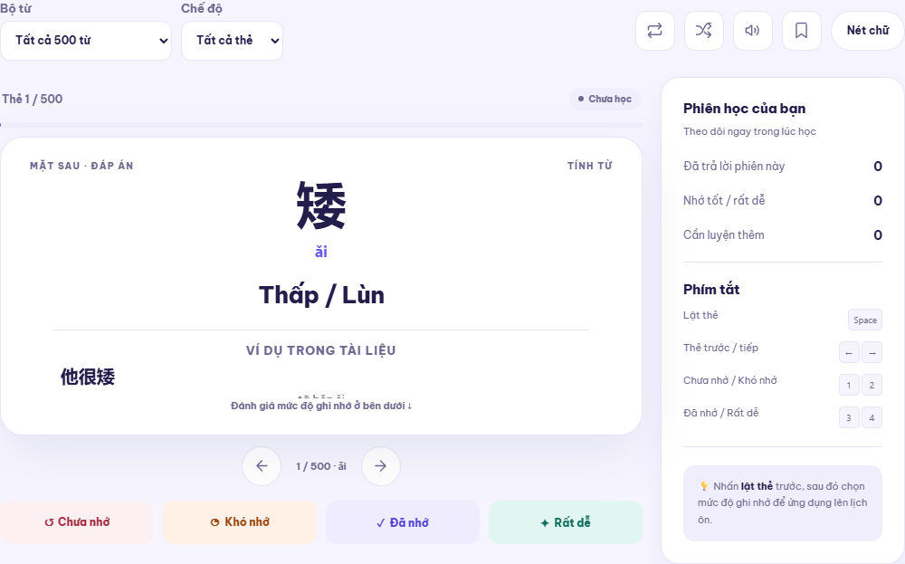
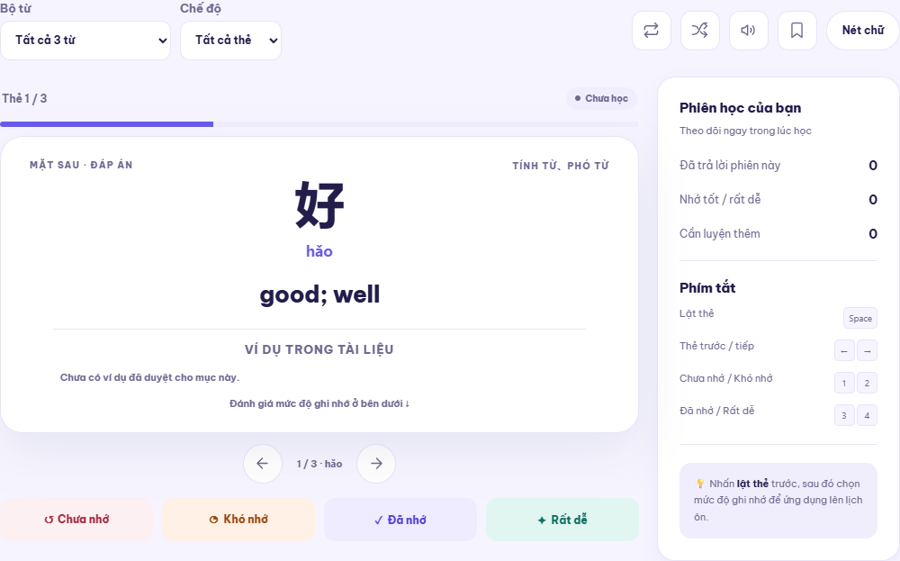
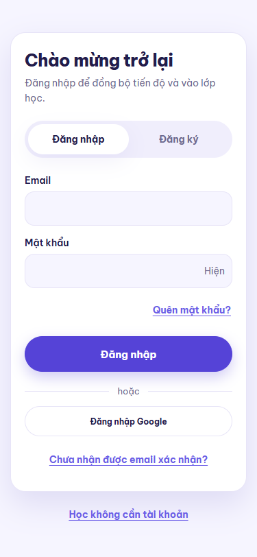
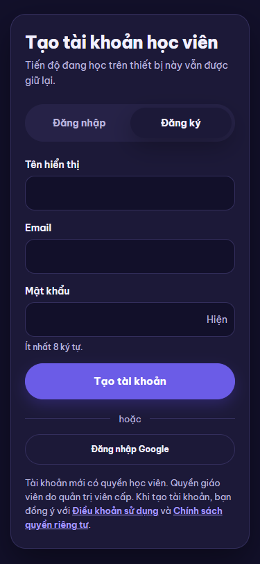
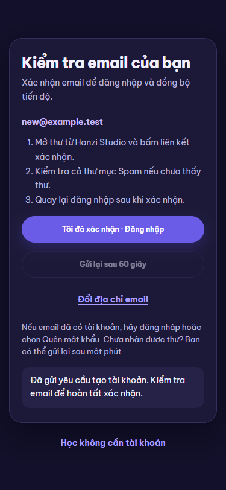

# Bảo trì Flashcard và tài khoản — 2026-10-31

Nền kiểm tra: `0095fb4`, nhánh sửa `codex/project-maintenance`. Phạm vi gồm thẻ học, tài khoản, xác nhận/reset mật khẩu, tiến độ, phát âm, build/PWA và các trang hiện có. Kết quả mã nguồn không thay cho việc người học nhận thư trong Gmail thật.

## Phát hiện và thay đổi

| Mức | Phát hiện | Đã xử lý |
| --- | --- | --- |
| Cao | So DOM chưa phát hiện CSS thư viện ép chữ Hán xuống 48px | Giới hạn CSS cũ ra ngoài vùng học; dùng một `.study-workspace` chứa toolbar, thẻ và cột phiên học; so computed styles trên mọi nguồn |
| Vừa | Thiếu công cụ; lật thẻ dựng lại toàn vùng và cuộn trang | Toolbar gốc có đảo chiều/trộn/nghe/lưu/nét chữ theo nguồn; lật tại chỗ, chỉ cuộn khi cần để thấy thẻ/đánh giá |
| Cao | Auth chờ vô hạn hoặc mất thông tin khi lỗi | Hạn 15 giây cho toàn thao tác, hủy khi đổi màn, bỏ phản hồi trễ, giữ input và có thử lại phiên |
| Cao | PKCE phụ thuộc trình duyệt ban đầu; link một lần có thể bị bộ quét dùng trước | Hai mẫu thư dùng `TokenHash`; trang xóa token khỏi URL và chỉ gọi `verifyOtp` khi người học bấm xác nhận |
| Cao | Reset mất trạng thái sau khi đổi chủ tiến độ/reload | Marker sessionStorage gắn đúng user ID, xóa khi đổi mật khẩu/đăng xuất; không dùng marker thay session/RLS |
| Vừa | Login chặn mật khẩu cũ ngắn hơn 8 ký tự; nút hiện mật khẩu lệch vào gợi ý | Tách quy tắc login/tạo mật khẩu; sửa input/toggle, tab bàn phím và thông báo lỗi cho screen reader |
| Vừa | Nút Google thiếu tương phản ở dark mode/khi đổi theme | Màu theo theme, không chuyển màu nền gây nháy; regression yêu cầu ít nhất 4,5:1 |
| Cao | HTML mới có thể dùng JS/CSS cũ từ worker | Gắn cùng phiên bản cho JS/CSS; chỉ dùng cache đúng phiên bản. Regression cài worker cũ cố tình trả bundle lỗi thời |
| Cao | Audio chờ mạng có thể phát sau khi đổi tài khoản | Hủy request, chặn kết quả cũ, dừng audio, thu hồi URL/cache theo phiên |
| Vừa | Bookmark lưu lỗi vẫn đổi bộ nhớ; backup chỉ kiểm tra object ngoài | Hoàn tác bookmark, không báo thành công khi chưa lưu; kiểm tra cấu trúc nhóm trước xác nhận/ghi backup |

Bookmark/SRS của HSK 3 Việt, CLEC, tham khảo và Lộ trình giữ ID riêng. Không gộp công thức lịch ôn. Không tạo nghĩa Việt hoặc xuất bản câu chưa duyệt để làm thẻ trông đầy đủ hơn.

## Luồng email

1. Đăng ký → màn kiểm tra email, giữ địa chỉ, hướng dẫn Spam, đăng nhập/đổi email. Gửi lại có bộ đếm 60 giây; server vẫn thực thi giới hạn thật.
2. Link mới: `index.html?token_hash=...&type=email#auth` hoặc `type=recovery`. Xem trước trang chưa tiêu thụ token. Lỗi/hết hạn có lối gửi lại hoặc đăng nhập.
3. Link cũ `?code=` vẫn được SDK xử lý; giữ hướng dẫn khi thiếu verifier ở trình duyệt khác.
4. Reset hợp lệ giữ đúng màn đặt mật khẩu qua reload khi khôi phục tiến độ theo tài khoản.
5. Phát hành frontend hỗ trợ link mới trước khi áp dụng hai template. Bản vá SMTP không thay Site URL, quyền hoặc Google provider; secret không vào build.

Nguồn kỹ thuật: [Supabase email templates, OTP và email prefetching](https://supabase.com/docs/guides/auth/auth-email-templates), [POST verify trả session trong server chính thức](https://github.com/supabase/auth/blob/master/internal/api/verify.go).

## Kiểm chứng local

| Kiểm tra | Kết quả |
| --- | --- |
| Node unit tests | 64/64 |
| Playwright | 99/99; thêm 18 regression so với nền |
| Toàn bộ route | 27 trang × desktop/mobile × light/dark = 108; không lỗi JS, 404 nội bộ, ID trùng hoặc tràn ngang |
| Parse mã/dữ liệu | 92 JS/MJS, 66 JSON, 2 Python; không lỗi |
| Phụ thuộc runtime | `npm audit --omit=dev`: 0 lỗ hổng được báo |
| Database | Không đổi migration. Docker local chưa chạy; database phải qua CI đúng commit phát hành |
| SMTP | Credential gốc trong `.env.local` được Gmail chấp nhận qua TLS/STARTTLS; phép kiểm tra không gửi email |

E2E dùng tài khoản/API/audio giả; không gọi model/provider thật. Kiểm tra route/cú pháp là kiểm tra tổng thể, không có nghĩa đã đọc thủ công từng dòng mọi file hay đã duyệt nội dung sư phạm. Review OCR phần thay đổi ghi đủ file đã review/bỏ qua; tài liệu và ảnh kiểm tra riêng.

SMTP login thành công và HTTP 200 của signup không chứng minh thư đã đến hộp thư. Gửi từ Supabase → nhận Gmail → bấm link, cùng callback Google thật, cần nghiệm thu riêng. Không tự tạo tài khoản hay gửi thư tới người thật trong kiểm thử.

## Ảnh kiểm tra

Ảnh từ mã đang kiểm tra, dùng dữ liệu giả:

| Mẫu gốc | CLEC dùng chung workspace |
| --- | --- |
|  |  |

| Đăng nhập mobile | Đăng ký dark mode | Bước kiểm tra email |
| --- | --- | --- |
|  |  |  |

## Bảo trì tiếp

- Giữ template/CSS workspace tại một nơi; kiểm tra cả style, công cụ và hành vi, không chỉ cây DOM.
- Thay đổi Auth phải có ca chờ mạng, SMTP lỗi, link hết hạn, trình duyệt khác và reload khi đổi chủ tiến độ.
- Giữ xác nhận email và phân quyền; không né lỗi gửi mail bằng tự xác nhận tài khoản.
- 50 câu pilot còn ở nháp, hai nghĩa thiếu và nghĩa Việt cho CLEC vẫn là công việc biên tập riêng.
